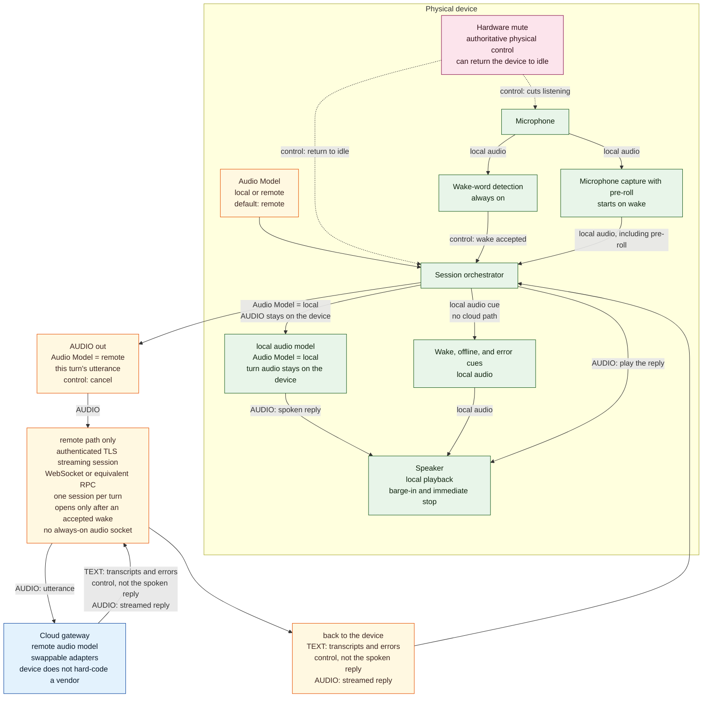

# Architecture of record: hybrid

**Baseline decision:** hybrid. Always-on listening and playback stay on the device. The device has one setting, Audio Model. The only labels for that choice are `local` and `remote`. The default is `remote`.

When Audio Model is `remote`, after an accepted wake word the device streams that turn's audio to a cloud gateway. The remote audio model runs behind the gateway, and the device plays the streamed reply locally.

When Audio Model is `local`, after an accepted wake word the local audio model processes that turn on the device. The audio does not leave the device for the model call, and the spoken reply plays locally.

`remote` is the practical default while hardware is not locked down: it keeps the privacy boundary at the wake word, meets conversational latency with streaming, and avoids asking a first-generation board to run the audio model.

This is the approved project baseline. Nir Miya approved the hybrid design on 25 Nov 2026 at 1:32 PM Asia/Hong_Kong. The technical design is recorded from the source comment at https://github.com/ndeivasi/hardware-voice-ai/issues/11#issuecomment-7153862494. Nir Miya approved this simpler settings direction on 25 Nov 2026 at 7:16 PM Asia/Hong_Kong: one Audio Model setting, with labels `local` and `remote` only. Separate Speech-to-Text, Text Destination, and Text-to-Speech settings were considered and deferred as too complicated for now. They are not current settings. [Issue 10](https://github.com/ndeivasi/hardware-voice-ai/issues/10) is closed as completed. [Issue 11](https://github.com/ndeivasi/hardware-voice-ai/issues/11) remains open for later architecture changes.

Nir unlocked implementation on 25 Nov 2026 at 7:26 PM Asia/Hong_Kong ([issue 12](https://github.com/ndeivasi/hardware-voice-ai/issues/12)). Issues #1–#9 are `status:todo`.

### High-level design

This is the primary view of the approved baseline. Wake-word detection, microphone capture, and speaker playback stay on the device in both Audio Model choices. The remote audio model is the default cloud path. The local audio model keeps that turn on the device.

#### Audio Model

The only device setting for where the turn's model runs is Audio Model. Its only labels are `local` and `remote`. The default is `remote`.

- **`remote` (default).** After an accepted wake, the device opens one authenticated TLS streaming session (WebSocket or equivalent RPC) and streams that turn's audio to the cloud gateway. There is no always-on audio socket. The device does not send text from a model running on the device. The remote audio model runs behind the gateway. The device must not hard-code a vendor; the gateway holds swappable adapters. The gateway sends partial and final transcripts, and errors, back as text control messages. Those transcripts are not the spoken reply. The spoken reply returns as streamed audio for local playback. A cancel on the session is a control message, not audio.
- **`local`.** After an accepted wake, that turn's audio is processed on the device by the local audio model and does not leave the device for the model call. The spoken reply plays locally. There is no cloud session for the model call. A local audio model has tighter on-device compute requirements than the remote default.
- **Cues.** Wake, offline, and error cues are local audio in either mode. They do not use a cloud audio path.

Separate Speech-to-Text, Text Destination, and Text-to-Speech settings were considered and deferred as too complicated for now. They are not current settings.



`local` keeps that turn's audio on the device and plays the reply there. `remote` is the default: after wake, the device sends audio and receives transcript text plus streamed reply audio. Playback is on the device in both modes. Wake, offline, and error cues are local audio either way.

### Assumptions

- Specific hardware is not chosen yet. Design for a Linux-class single-board computer (Raspberry Pi-class or similar) with at least one microphone and a speaker, and keep audio, model, and transport interfaces swappable when a board is picked.
- First form factor is not decided (desk, around the room, or carried). The baseline assumes a powered device that may be used across a room. A battery-powered, carried product would tighten the always-on power budget and may need a low-power wake DSP.
- The default Audio Model is `remote`: speech-to-text, the language model, and text-to-speech run behind the gateway, with swappable adapters. The device does not hard-code a vendor. Audio Model `local` runs that turn on the device instead. The device state machine is the same for both labels. Separate Speech-to-Text, Text Destination, and Text-to-Speech settings are not part of this baseline.
- Network will sometimes be unavailable. The device must still wake and capture. When Audio Model is `remote`, it says it is offline rather than hang. When Audio Model is `local`, the model call does not need the network.
- Product needs already raised by the User advocate (not yet formal acceptance criteria): hear the user the first time from across the room without triggering on TV or other talk; after wake, catch the request even if speech starts immediately; stop listening when the user is done; speak back what it heard if it may have misheard, so correction can be spoken; keep spoken answers short; stop immediately on request; never send a message, buy something, or take an irreversible action without confirmation; provide a clear way to turn the microphone off completely.

### System topology

The mermaid diagram above is the primary high-level view, including Audio Model `local` and `remote`. The sketch below is the original source layout of the `remote` path.

```
[mics] -> capture/pre-roll buffer -> wake-word engine (on-device, always on)
                                      |
                                      | wake accepted
                                      v
                               session orchestrator (on-device)
                                      |
          audio stream + control  <-->  transcript / TTS audio / events
                                      v
                               cloud gateway (TLS)
                                      |
                         +------------+------------+
                         v            v            v
                       STT           LLM          TTS
                    (streaming)   (API, stream) (streaming)
                                      |
                               [speaker] <-- playback / barge-in (on-device)
                               hardware mute (authoritative)
```

The device owns the session state machine: `idle → woken → capturing → transcribing → thinking → speaking → idle`. Cancel and mute can return to `idle` from any later state.

### Per-stage placement

These stages describe the pipeline. They are not extra device settings. The only device setting is Audio Model (`local` or `remote`). When Audio Model is `local`, one local audio model handles the turn on the device. The cloud placements below are the `remote` default.

| Stage | Placement | Why |
| --- | --- | --- |
| Wake word detection | On-device only | Always-on audio must not leave the device. Local detection is the only way to get low latency, privacy, and a hard listening boundary. |
| Microphone capture | On-device only | Raw audio and a short pre-roll buffer stay local. Capture starts on wake (including audio from just before the wake word ends) and stops on end-of-utterance or cancel. |
| Speech-to-text | `remote` default: cloud, streaming, behind the gateway | Quality and far-field robustness are better in the cloud for a first hardware target. The device streams only the post-wake utterance. This is not a separate device setting. |
| Language model API call | `remote` default: cloud API, behind the gateway | A useful general model is not practical on the assumed first board, which is why `remote` is the default. The gateway holds vendor credentials and adapters; the device should not hard-code a provider. |
| Text-to-speech | `remote` default: cloud, streaming, plus local cues in either mode | When Audio Model is `remote`, spoken replies stream back as audio. Wake, offline, and error cues are local audio for both `local` and `remote`. |
| Speaker output | On-device only | Playback, volume, and immediate stop/barge-in are local in both modes. The speaker path must be interruptible so a new wake or "stop" is not blocked by playback. |

### Inter-component communication

- On the device, wake word, capture, the session orchestrator, and playback should be tightly coupled (one process or a local message bus). They share the live mic stream and a pre-roll ring buffer so the user can start speaking immediately after the wake word.
- When Audio Model is `remote`: one authenticated TLS session per turn (WebSocket or equivalent RPC), opened only after an accepted wake. Control messages and audio frames share that session. The device sends that turn's audio, and may send a cancel. The gateway sends the partial transcript, the final transcript, streamed reply audio, and errors. The transcripts are text control messages, not the spoken reply.
- When Audio Model is `local`: that turn's audio is processed by the local audio model and does not leave the device for the model call. The spoken reply is local audio. There is no cloud session for the model call.
- The cloud gateway is a thin adapter in front of the remote audio model's providers. Prompts for confirmation of irreversible actions are applied here or in the orchestrator, not left to the model alone. The device must not hard-code a vendor.
- No always-on audio socket. If the network is down and Audio Model is `remote`, the orchestrator stays local and plays a local offline cue.

### Latency targets (design goals, not measured)

These are recommended targets for Audio Model `remote` on a powered device and a good network, to be validated once there is a build:

- Wake-word decision: about 200–300 ms after the end of the wake word, with pre-roll so the command is not clipped if the user starts immediately.
- First audio of the reply: under about 2 seconds, using streaming STT, a streaming model response, and streaming TTS. The rest of the reply can continue after playback has started.
- Immediate stop or barge-in: under about 200 ms from the stop cue to the speaker going quiet.

### Privacy

- Always-on audio never leaves the device. Audio can leave only after a wake word is accepted (or the user has otherwise started a turn), and only when Audio Model is `remote`.
- When Audio Model is `local`, that turn's audio does not leave the device for the model call.
- A hardware microphone mute (or equally clear physical control) is authoritative and must be obvious in use.
- Do not persist raw audio by default. Detection logs for testing should be local and opt-in.
- When Audio Model is `remote`, the cloud should not retain audio or transcripts beyond the turn unless the user later opts into history.
- When Audio Model is `remote`, be explicit that after wake the utterance audio, and the transcript produced from it, goes to third-party providers through the gateway.
- Irreversible actions require a spoken confirmation before execution.

### Hardware constraints

- Budget always-on compute for a small wake-word model. The `remote` default does not also run the audio model on the device. If the product becomes battery-powered or carried, add a low-power wake path (DSP or equivalent) as a requirement.
- Keep a short local pre-roll (on the order of a few hundred milliseconds to about a second) so capture does not clip the start of the request.
- Far-field use (across the room) benefits from a microphone array and acoustic echo cancellation for barge-in while the speaker is playing. v1 can start with a single mic behind the same interfaces, but those interfaces should not assume one mic.
- Do not require an NPU or large RAM for the `remote` default. Audio Model `local` has tighter on-device compute requirements than that default, because the local audio model runs the turn on the device. Hardware is not chosen yet, so `remote` stays the practical default until a board can carry the local model.

### Implications for open implementation issues

- [Issue 1](https://github.com/ndeivasi/hardware-voice-ai/issues/1) (wake word) and [issue 2](https://github.com/ndeivasi/hardware-voice-ai/issues/2) (mic capture) are on-device, with a handoff through the orchestrator and a pre-roll buffer. A portable, swappable wake model is consistent with this baseline.
- [Issues 3–5](https://github.com/ndeivasi/hardware-voice-ai/issues/3), when Audio Model is `remote`, should talk to a cloud gateway behind stable interfaces. The device must not hard-code a vendor. When Audio Model is `local`, that turn does not go to the gateway for the model call.
- [Issue 6](https://github.com/ndeivasi/hardware-voice-ai/issues/6) must support interruption and local cue playback.
- [Issue 1](https://github.com/ndeivasi/hardware-voice-ai/issues/1) (wake word) is implemented on-device against this baseline: a portable wake model, documented assumptions, and a pre-roll handoff to the session orchestrator. It does not add a cloud speech-to-text, language-model, or text-to-speech pipeline. Issues #2–#9 remain open on `status:todo`.

This baseline is the approved answer to [issue 10](https://github.com/ndeivasi/hardware-voice-ai/issues/10), which is closed as completed. [Issue 11](https://github.com/ndeivasi/hardware-voice-ai/issues/11) remains open for later architecture changes, which should be approved before they replace this baseline.

### Open questions that do not block this baseline

- Exact wake word and language.
- Formal board and microphone/speaker selection.
- First form factor (desk, room, or carried), which mainly affects power and far-field requirements.
- Which providers the gateway uses for the `remote` audio model.
- Which local audio model is used when Audio Model is `local`.
