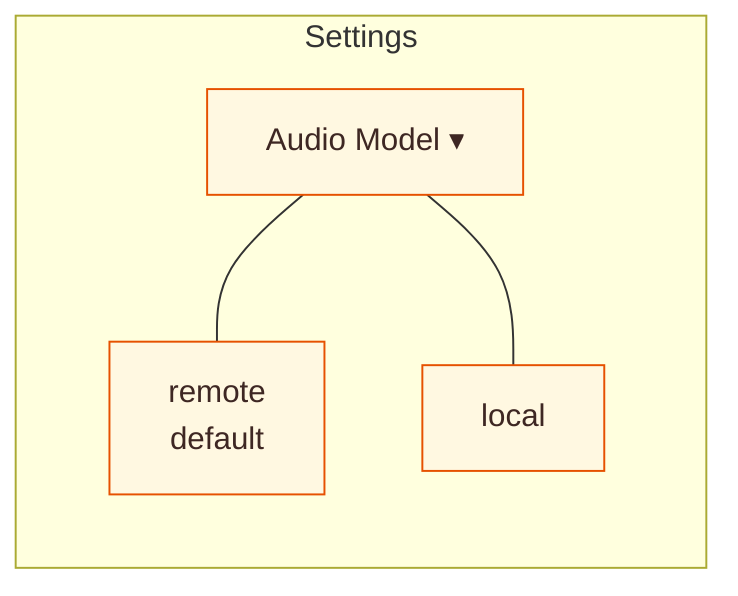
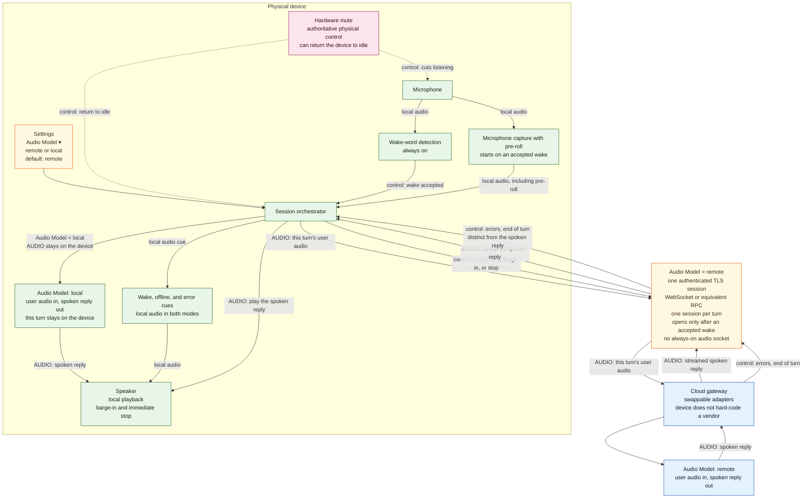

# Architecture of record: hybrid

**Baseline decision:** hybrid. Always-on listening and playback stay on the device. Settings have a single Audio Model choice, shown as one dropdown. The only options are `local` and `remote`. The default is `remote`.

`local` means on-device. `remote` means a cloud service. Those are the only labels for this choice.

That one Audio Model handles the full voice loop in both modes. It receives the user's audio and produces the spoken reply. There is no separate speech-to-text step, no separate text destination, and no text-to-speech step.

When Audio Model is `remote`, after an accepted wake the device streams that turn's audio to a cloud gateway over one authenticated TLS session. The remote Audio Model runs behind the gateway, and the spoken reply returns as streamed audio for local playback.

When Audio Model is `local`, after an accepted wake the local Audio Model processes that turn on the device. The audio does not leave the device for the model call, and the spoken reply plays locally. This needs tighter on-device compute than the remote default.

`remote` is the practical default while hardware is not locked down: it keeps the privacy boundary at the wake word, meets conversational latency with streaming, and avoids asking a first-generation board to run the Audio Model.

This is the approved project baseline. Nir Miya approved the hybrid design on 25 Nov 2026 at 1:32 PM Asia/Hong_Kong. The technical design is recorded from the source comment at https://github.com/ndeivasi/hardware-voice-ai/issues/11#issuecomment-7153862494. Nir Miya approved one Audio Model setting, with the labels `local` and `remote` only, on 25 Nov 2026 at 7:16 PM Asia/Hong_Kong. Nir Miya approved this tighter design in chat with Architect on 25 Nov 2026 at 7:24 PM Asia/Hong_Kong. It replaces prior multi-toggle designs. The Audio Model is the one component that consumes the user's audio and produces the spoken reply. [Issue 10](https://github.com/ndeivasi/hardware-voice-ai/issues/10) is closed as completed. [Issue 11](https://github.com/ndeivasi/hardware-voice-ai/issues/11) remains open for later architecture changes.

Implementation is unlocked. Nir unlocked it on 25 Nov 2026 at 7:26 PM Asia/Hong_Kong. [Issue 12](https://github.com/ndeivasi/hardware-voice-ai/issues/12) is closed. Wake word ([issue 1](https://github.com/ndeivasi/hardware-voice-ai/issues/1)), microphone capture ([issue 2](https://github.com/ndeivasi/hardware-voice-ai/issues/2)), the one Audio Model voice loop ([issues 3–5](https://github.com/ndeivasi/hardware-voice-ai/issues/3)), and speaker playback ([issue 6](https://github.com/ndeivasi/hardware-voice-ai/issues/6)) are implemented. Issues 7–9 remain open.

### High-level design

Wake-word detection, microphone capture, and speaker playback stay on the device in both Audio Model choices. The setting is one dropdown. The Audio Model selected there handles the full voice loop: user audio in, spoken reply out. `remote` is the default cloud path. `local` keeps that turn on the device.

#### Settings

The only device setting for the voice loop is Audio Model. It is one dropdown. The options are `local` and `remote`. The default is `remote`.



#### Audio Model

The selected Audio Model receives the user's audio and produces the spoken reply. The same component does that work in both modes. The mode chooses where it runs.

- **`remote` (default).** Only after an accepted wake, the device opens one authenticated TLS session (WebSocket or equivalent RPC) and streams that turn's audio to the cloud gateway. There is no always-on audio socket. The selected Audio Model (`remote`) runs behind the gateway. The device must not hard-code a vendor; the gateway holds swappable adapters. Those adapters are Moshi (the default), MiniCPM-o 4.5, and Qwen3-Omni Instruct. Choosing one is not a third Audio Model label. They need a GPU and do not run on a Pi-class board. The spoken reply returns as streamed audio for local playback. Control messages on the session, when needed, are errors, end of turn, and barge-in/stop. Those control messages are distinct from the spoken reply, which is audio.
- **`local`.** After an accepted wake, that turn's audio is processed on the device by the local Audio Model and does not leave the device for the model call. The spoken reply plays locally. There is no cloud session for the model call. The on-device stand-in is `reference-audio-v1`. It is not one of the remote GPU adapters. A local Audio Model has tighter on-device compute requirements than the remote default.
- **Cues.** Wake, offline, and error cues are local audio in both modes. They do not use a cloud audio path.



`local` keeps that turn's audio on the device. The local Audio Model consumes it and the spoken reply plays there. `remote` is the default: after an accepted wake, the device streams that turn's audio to the gateway and plays the streamed spoken reply locally. Playback is on the device in both modes. Wake, offline, and error cues are local audio either way. Control messages are errors, end of turn, and barge-in/stop. The spoken reply is audio.

#### Confirmation and failure

When confirmation is needed, the user hears what the device understood because the Audio Model speaks it. That covers a possible mishearing and a confirmation before an irreversible action. The spoken confirmation is part of the spoken reply and plays on the local speaker in both `local` and `remote`. The user can correct it by speaking. This is audio from the Audio Model. It is not a transcript carried as a control message.

On failure, three paths stay available, and none of them is a transcript:

- The device plays a local error cue in both modes. When Audio Model is `remote` and the network is down, that cue is the local offline cue. The orchestrator stays on the device.
- When Audio Model is `remote`, the gateway can send an error control message on the turn's session. That message stays distinct from the spoken reply.
- The Audio Model can also speak the failure as part of the spoken reply. That spoken failure is audio and plays locally, in either mode.

### Assumptions

- Specific hardware is not chosen yet. Design for a Linux-class single-board computer (Raspberry Pi-class or similar) with at least one microphone and a speaker, and keep audio, model, and transport interfaces swappable when a board is picked.
- First form factor is not decided (desk, around the room, or carried). The baseline assumes a powered device that may be used across a room. A battery-powered, carried product would tighten the always-on power budget and may need a low-power wake DSP.
- The default Audio Model is `remote`: one cloud service behind the gateway receives the user's audio and produces the spoken reply, with swappable adapters. The device does not hard-code a vendor. The gateway process on a GPU host selects Moshi (default), MiniCPM-o 4.5, or Qwen3-Omni Instruct. That choice is not another Audio Model label. Audio Model `local` runs that same full voice loop on the device, with `reference-audio-v1` as the stand-in. The device state machine is the same for both labels. The only Audio Model setting is the dropdown (`local` or `remote`).
- Network will sometimes be unavailable. The device must still wake and capture. When Audio Model is `remote`, it says it is offline rather than hang. When Audio Model is `local`, the model call does not need the network.
- Product needs already raised by the User advocate (not yet formal acceptance criteria): hear the user the first time from across the room without triggering on TV or other talk; after wake, catch the request even if speech starts immediately; stop listening when the user is done; speak back what it heard if it may have misheard, so correction can be spoken; keep spoken answers short; stop immediately on request; never send a message, buy something, or take an irreversible action without confirmation; provide a clear way to turn the microphone off completely. Confirmation and failure both stay on the audio path described below.

### System topology

The mermaid diagram above is the primary high-level view, including Audio Model `local` and `remote`. The sketch below is the `remote` path. `local` uses the same orchestrator and does not open this session: the local Audio Model handles that turn on the device.

```
[mics] -> capture/pre-roll buffer -> wake-word engine (on-device, always on)
                                      |
                                      | wake accepted
                                      v
                               session orchestrator (on-device)
                                      |
          user audio + control   <-->  spoken-reply audio + control
          (one authenticated TLS session after wake;
           no always-on audio socket)
                                      v
                               cloud gateway
                               swappable adapters
                               device does not hard-code a vendor
                                      |
                                      v
                               Audio Model (remote)
                               user audio in, spoken reply out
                                      |
                               [speaker] <-- playback / barge-in (on-device)
                               hardware mute (authoritative)
                               wake, offline, and error cues (local audio)
```

The device owns the session state machine: `idle → woken → capturing → speaking → idle`. During the turn the Audio Model receives the user's audio and produces the spoken reply. The model runs off the microphone thread, so the always-on loop keeps reading frames. Playback of that reply is local and can begin while the reply is still streaming. The session stays in `speaking` until that playback finishes flushing, so a wake during the tail still stops the speaker. Cancel and hardware mute return the session to `idle` from any later state. Hardware mute stops playback and does not resume it when released. A wake accepted during `speaking` cancels that Audio Model turn, stops playback, and starts a new capture. A local cue is kept out of the capture buffer and is not accepted as another wake.

`DeviceState` still includes `transcribing` and `thinking` from an earlier draft of this chain. Speaker playback enters `speaking` from `capturing` after the microphone tap closes. Removing `transcribing` and `thinking` remains a follow-up. Those names are not Audio Model settings, and this package does not run them.

### Component placement

These parts describe where the work runs. They are not extra device settings. The only device setting is the Audio Model dropdown (`local` or `remote`). In both modes that one model receives the user's audio and produces the spoken reply.

| Part | Placement | Why |
| --- | --- | --- |
| Wake word detection | On-device only | Always-on audio must not leave the device. Local detection is the only way to get low latency, privacy, and a hard listening boundary. |
| Microphone capture | On-device only | Raw audio and a short pre-roll buffer stay local. Capture starts on an accepted wake (including audio from just before the wake word ends) and stops on end-of-utterance or cancel. |
| Audio Model | `remote` default: a cloud service behind the gateway. `local`: on the device | One model handles the full voice loop. It receives the user's audio and produces the spoken reply. `remote` fits a first board that should not have to run the model. The gateway holds the adapters, so the device does not hard-code a vendor. The adapters are Moshi (default), MiniCPM-o 4.5, and Qwen3-Omni Instruct, on a GPU host. `local` keeps that turn on the device. The stand-in is `reference-audio-v1`. |
| Speaker output | On-device only | Playback, volume, and immediate stop/barge-in are local in both modes. The speaker path must be interruptible so a new wake or "stop" is not blocked by playback. |
| Wake, offline, and error cues | On-device local audio in both modes | Cues stay local. They do not use the cloud audio path. |

### Inter-component communication

- On the device, wake word, capture, the session orchestrator, and playback should be tightly coupled (one process or a local message bus). They share the live mic stream and a pre-roll ring buffer so the user can start speaking immediately after the wake word.
- When Audio Model is `remote`: one authenticated TLS session per turn (WebSocket or equivalent RPC), opened only after an accepted wake. There is no always-on audio socket. The device streams that turn's audio to the cloud gateway. The remote Audio Model runs behind the gateway. The session carries length-prefixed JSON control and PCM audio; the spoken reply is the audio, and the gateway runs Moshi by default. Control messages on that session are limited to errors, end of turn, and barge-in/stop, and they stay distinct from the spoken reply. The frame layout is [remote-backends.md](remote-backends.md).
- When Audio Model is `local`: that turn's audio is processed by the local Audio Model and does not leave the device for the model call. The spoken reply is local audio. There is no cloud session for the model call.
- The cloud gateway is a thin adapter in front of the remote Audio Model. Prompts for confirmation of irreversible actions are applied here or in the orchestrator, not left to the model alone. The device must not hard-code a vendor; the gateway holds swappable adapters.
- No always-on audio socket. If the network is down and Audio Model is `remote`, the orchestrator stays local and plays a local offline cue. Other failures use the same split: a local error cue, an error control message on the remote session when that session exists, and, when the Audio Model can still respond, a spoken failure in the reply audio.

### Latency targets (design goals, not measured)

These are recommended targets for Audio Model `remote` on a powered device and a good network, to be validated once there is a build:

- Wake-word decision: about 200–300 ms after the end of the wake word, with pre-roll so the command is not clipped if the user starts immediately.
- First audio of the spoken reply: under about 2 seconds, by streaming that turn's audio to the remote Audio Model and streaming the spoken reply back. The rest of the reply can continue after playback has started.
- Immediate stop or barge-in: under about 200 ms from the stop cue to the speaker going quiet.

### Privacy

- Always-on audio never leaves the device. Audio can leave only after a wake word is accepted (or the user has otherwise started a turn), and only when Audio Model is `remote`.
- When Audio Model is `local`, that turn's audio does not leave the device for the model call.
- A hardware microphone mute (or equally clear physical control) is authoritative and must be obvious in use.
- Do not persist raw audio by default. Detection logs for testing should be local and opt-in.
- When Audio Model is `remote`, the cloud service should not retain that turn's audio beyond the turn unless the user later opts into history.
- When Audio Model is `remote`, be explicit that after an accepted wake that turn's audio goes to the remote Audio Model through the gateway.
- Irreversible actions require a spoken confirmation before execution.

### Hardware constraints

- Budget always-on compute for a small wake-word model. The `remote` default does not also run the Audio Model on the device. If the product becomes battery-powered or carried, add a low-power wake path (DSP or equivalent) as a requirement.
- Keep a short local pre-roll (on the order of a few hundred milliseconds to about a second) so capture does not clip the start of the request.
- Far-field use (across the room) benefits from a microphone array and acoustic echo cancellation for barge-in while the speaker is playing. v1 can start with a single mic behind the same interfaces, but those interfaces should not assume one mic.
- Do not require an NPU or large RAM for the `remote` default. Audio Model `local` has tighter on-device compute requirements than that default, because the local Audio Model runs the full voice loop on the device. Hardware is not chosen yet, so `remote` stays the practical default until a board can carry the local model.

### Implications for open implementation issues

- [Issue 1](https://github.com/ndeivasi/hardware-voice-ai/issues/1) (wake word) is implemented on-device: a portable wake model, documented assumptions, and a pre-roll handoff to the session orchestrator. [Issue 2](https://github.com/ndeivasi/hardware-voice-ai/issues/2) (microphone capture) is implemented on-device and hands the post-wake utterance to that orchestrator.
- [Issue 3](https://github.com/ndeivasi/hardware-voice-ai/issues/3), [issue 4](https://github.com/ndeivasi/hardware-voice-ai/issues/4), and [issue 5](https://github.com/ndeivasi/hardware-voice-ai/issues/5) are one Audio Model voice loop. It receives the user's audio and produces the spoken reply. A `remote` Audio Model talks to the cloud gateway behind stable interfaces, and the device must not hard-code a vendor. A `local` Audio Model does not send that turn off the device for the model call. The model runs off the microphone thread. A wake during speaking cancels the turn, stops playback, and starts a new capture.
- [Issue 6](https://github.com/ndeivasi/hardware-voice-ai/issues/6) (speaker playback) is implemented on the device: reply audio, volume, interruption, and local wake, offline, and error cues. See [playback.md](playback.md). A wake during speaking cuts playback. Hardware mute stops playback and does not resume it when released. Local cues are kept out of capture and wake scoring.
- [Issues 7–9](https://github.com/ndeivasi/hardware-voice-ai/issues/7) remain open.
- `DeviceState` still includes `transcribing` and `thinking`. Playback enters `speaking` from `capturing`. Removing the unused states remains a follow-up.

This baseline is the approved answer to [issue 10](https://github.com/ndeivasi/hardware-voice-ai/issues/10), which is closed as completed. [Issue 11](https://github.com/ndeivasi/hardware-voice-ai/issues/11) remains open for later architecture changes, which should be approved before they replace this baseline.

### Remote speech-to-speech adapters

When Audio Model is `remote`, the gateway runs one open-weight speech-to-speech adapter. Speech-to-text and text-to-speech stay inside that model. They are not pipeline stages and they are not settings.

| Adapter | Id | Default | Weights | Where it runs |
| --- | --- | --- | --- | --- |
| Moshi | `moshi` | yes | 7B, CC-BY 4.0 | GPU host, behind the gateway |
| MiniCPM-o 4.5 | `minicpm-o-4.5` | | 9B, Apache-2.0 | GPU host, behind the gateway |
| Qwen3-Omni Instruct | `qwen3-omni` | | Apache-2.0, heavier than the other two | GPU host, behind the gateway |

The local stand-in stays `reference-audio-v1`. It is not one of these adapters.

The design is still one authenticated TLS session per turn after an accepted wake. This package is the server for that session. The device package on main does not dial it: `DeviceConfig` has no gateway URL. A later device client should use `tls://<gpu-host>:<port>` and the same non-empty `HVA_GATEWAY_TOKEN`. The gateway refuses to start without that secret. It is not a model-vendor key. The repository does not ship a certificate, a key, or a token. The GPU host is a separate machine. A Pi-class board runs wake, capture, and playback, and does not load these models.

The gateway is what holds the vendor calls. Replacing how Moshi, MiniCPM-o, or Qwen3-Omni is constructed does not change the device session. Setup for the GPU host is [remote-backends.md](remote-backends.md).

### Open questions that do not block this baseline

- Exact wake word and language.
- Formal board and microphone/speaker selection.
- First form factor (desk, room, or carried), which mainly affects power and far-field requirements.
- Which production model runs when Audio Model is `local`. The stand-in is `reference-audio-v1`. The three remote adapters need a GPU, so they are not that on-device model.
