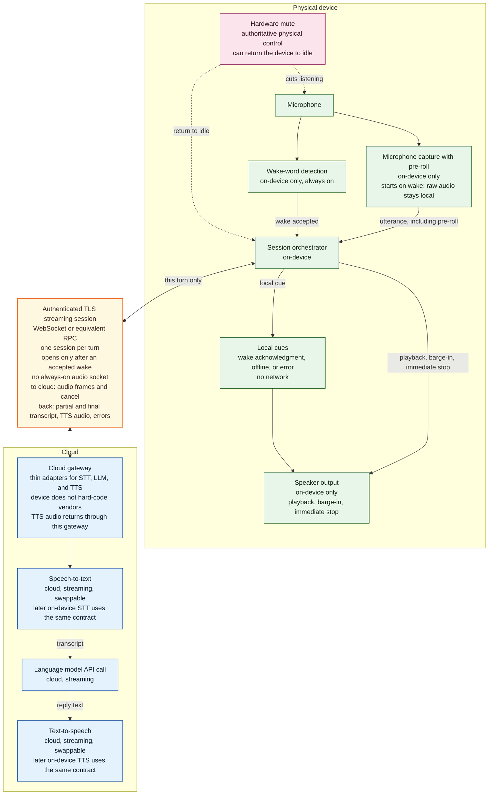

# Architecture of record: hybrid

**Baseline decision:** hybrid. Always-on listening and playback stay on the device. After an accepted wake word, the device streams that turn's audio to a cloud gateway for speech-to-text, the language model, and text-to-speech, then plays the reply locally.

This is the practical default while hardware is not locked down: it keeps the privacy boundary at the wake word, meets conversational latency with streaming, and avoids asking a first-generation board to run a large language model.

This is the approved project baseline, approved by Nir Miya on 25 Nov 2026 at 1:32 PM Asia/Hong_Kong. The technical design is recorded from the source comment at https://github.com/ndeivasi/hardware-voice-ai/issues/11#issuecomment-7153862494. [Issue 10](https://github.com/ndeivasi/hardware-voice-ai/issues/10) is closed as completed. [Issue 11](https://github.com/ndeivasi/hardware-voice-ai/issues/11) remains open for later architecture changes.

Implementation remains blocked. Issues #1–#9 stay on `status:blocked` until Nir explicitly unlocks them.

### High-level design

This is the primary view of the approved hybrid baseline. On-device stages are wake-word detection, microphone capture, and speaker output. Cloud stages are speech-to-text, the language model, and text-to-speech. Those cloud stages are reached only through the gateway, on a per-turn TLS session that opens after an accepted wake.



Green nodes stay on the device. Blue nodes are the cloud adapters. The session between them is the only path off the device.

### Assumptions

- Specific hardware is not chosen yet. Design for a Linux-class single-board computer (Raspberry Pi-class or similar) with at least one microphone and a speaker, and keep audio, model, and transport interfaces swappable when a board is picked.
- First form factor is not decided (desk, around the room, or carried). The baseline assumes a powered device that may be used across a room. A battery-powered, carried product would tighten the always-on power budget and may need a low-power wake DSP.
- v1 uses cloud STT, LLM, and TTS behind a server-side adapter. Those stages must be replaceable later (including an on-device STT/TTS path) without redesigning the device state machine.
- Network will sometimes be unavailable. The device must still wake, capture, and say it is offline rather than hang.
- Product needs already raised by the User advocate (not yet formal acceptance criteria): hear the user the first time from across the room without triggering on TV or other talk; after wake, catch the request even if speech starts immediately; stop listening when the user is done; speak back what it heard if it may have misheard, so correction can be spoken; keep spoken answers short; stop immediately on request; never send a message, buy something, or take an irreversible action without confirmation; provide a clear way to turn the microphone off completely.

### System topology

The mermaid diagram above is the primary high-level view. The sketch below is the same topology in the original source layout.

```
[mics] -> capture/pre-roll buffer -> wake-word engine (on-device, always on)
                                      |
                                      | wake accepted
                                      v
                               session orchestrator (on-device)
                                      |
          audio stream + control  <-->  transcript / TTS audio / events
                                      v
                               cloud gateway (TLS)
                                      |
                         +------------+------------+
                         v            v            v
                       STT           LLM          TTS
                    (streaming)   (API, stream) (streaming)
                                      |
                               [speaker] <-- playback / barge-in (on-device)
                               hardware mute (authoritative)
```

The device owns the session state machine: `idle → woken → capturing → transcribing → thinking → speaking → idle`. Cancel and mute can return to `idle` from any later state.

### Per-stage placement

| Stage | Placement (v1) | Why |
| --- | --- | --- |
| Wake word detection | On-device only | Always-on audio must not leave the device. Local detection is the only way to get low latency, privacy, and a hard listening boundary. |
| Microphone capture | On-device only | Raw audio and a short pre-roll buffer stay local. Capture starts on wake (including audio from just before the wake word ends) and stops on end-of-utterance or cancel. |
| Speech-to-text | Cloud, streaming, swappable | Quality and far-field robustness are better in the cloud for a first hardware target. The device streams only the post-wake utterance. The interface should allow a later on-device STT swap. |
| Language model API call | Cloud API | A useful general LLM is not practical on the assumed first board. The gateway holds vendor credentials and adapters; the device should not hard-code a provider. |
| Text-to-speech | Cloud, streaming, plus local cues | Spoken replies stream back as audio. Short local cues (a wake acknowledgment, an offline or error phrase) should be playable on-device with no network. |
| Speaker output | On-device only | Playback, volume, and immediate stop/barge-in are local. The speaker path must be interruptible so a new wake or "stop" is not blocked by playback. |

### Inter-component communication

- On the device, wake word, capture, the session orchestrator, and playback should be tightly coupled (one process or a local message bus). They share the live mic stream and a pre-roll ring buffer so the user can start speaking immediately after the wake word.
- Device to cloud: one authenticated TLS session per turn (WebSocket or equivalent streaming RPC). Control messages and audio frames share that session: the device sends audio after wake, and may send a cancel; the gateway sends partial transcript, the final transcript, streamed TTS audio, and errors.
- The cloud gateway is a thin adapter in front of STT, LLM, and TTS providers. Prompts for confirmation of irreversible actions are applied here or in the orchestrator, not left to the model alone.
- No always-on audio socket. If the network is down, the orchestrator stays local and plays an on-device offline cue.

### Latency targets (design goals, not measured)

These are recommended targets for a powered device on a good network, to be validated once there is a build:

- Wake-word decision: about 200–300 ms after the end of the wake word, with pre-roll so the command is not clipped if the user starts immediately.
- First audio of the reply: under about 2 seconds, using streaming STT, a streaming model response, and streaming TTS. The rest of the reply can continue after playback has started.
- Immediate stop or barge-in: under about 200 ms from the stop cue to the speaker going quiet.

### Privacy

- Audio never leaves the device until a wake word is accepted (or the user has otherwise started a turn).
- A hardware microphone mute (or equally clear physical control) is authoritative and must be obvious in use.
- Do not persist raw audio by default. Detection logs for testing should be local and opt-in.
- The cloud should not retain audio or transcripts beyond the turn unless the user later opts into history.
- Be explicit that after wake, the utterance text (and the audio sent for STT) goes to third-party STT/LLM/TTS providers through the gateway.
- Irreversible actions require a spoken confirmation before execution.

### Hardware constraints

- Budget always-on compute for a small wake-word model, not for STT+LLM+TTS. If the product becomes battery-powered or carried, add a low-power wake path (DSP or equivalent) as a requirement.
- Keep a short local pre-roll (on the order of a few hundred milliseconds to about a second) so capture does not clip the start of the request.
- Far-field use (across the room) benefits from a microphone array and acoustic echo cancellation for barge-in while the speaker is playing. v1 can start with a single mic behind the same interfaces, but those interfaces should not assume one mic.
- Do not require an on-device NPU or large RAM in v1. If a later board has an NPU, on-device STT/TTS can be swapped in behind the same contracts.

### Implications for open implementation issues

- [Issue 1](https://github.com/ndeivasi/hardware-voice-ai/issues/1) (wake word) and [issue 2](https://github.com/ndeivasi/hardware-voice-ai/issues/2) (mic capture) are on-device, with a handoff through the orchestrator and a pre-roll buffer. A portable, swappable wake model is consistent with this baseline.
- [Issues 3–5](https://github.com/ndeivasi/hardware-voice-ai/issues/3) should talk to a cloud gateway behind stable interfaces, not call vendors directly from device firmware.
- [Issue 6](https://github.com/ndeivasi/hardware-voice-ai/issues/6) must support interruption and local cue playback.
- A cloud agent was already started for issue 1 before this design was written. `main` still has no application code, and there is no implementation pull request. That work stays blocked with issues #1–#9. When Nir unlocks it, it should follow this baseline (on-device wake, portable implementation, documented assumptions) and should not expand into cloud STT/LLM/TTS.

This baseline is the approved answer to [issue 10](https://github.com/ndeivasi/hardware-voice-ai/issues/10), which is closed as completed. [Issue 11](https://github.com/ndeivasi/hardware-voice-ai/issues/11) remains open for later architecture changes, which should be approved before they replace this baseline.

### Open questions that do not block this baseline

- Exact wake word and language.
- Formal board and microphone/speaker selection.
- First form factor (desk, room, or carried), which mainly affects power and far-field requirements.
- Which STT, LLM, and TTS providers the gateway uses in v1.
